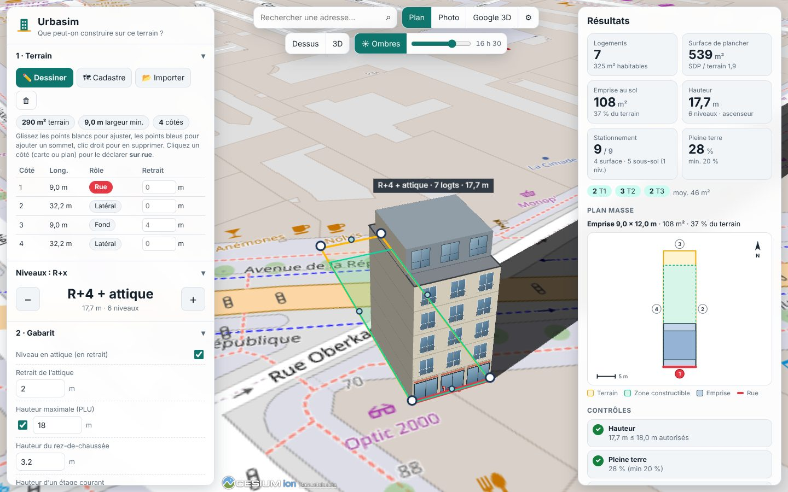

# Urbasim

**Que peut-on construire sur ce terrain ?** Urbasim est un simulateur de pré-faisabilité immobilière à la française
(et plus largement à l'européenne) : on dessine un terrain, on fixe ses critères (R+x, retraits, stationnement…) et
l'outil génère l'immeuble correspondant — en 3D dans son environnement, avec surfaces, nombre de logements et places
de stationnement.

Il vise le cas que les outils « à l'américaine » traitent mal : **l'immeuble étroit sur petite parcelle**, construit en
mitoyenneté, comme on en fait partout en centre-ville.



## Démarrage

Prérequis : Node.js 20 ou plus.

```bash
npm install
npm run dev        # http://localhost:5173
```

Autres commandes : `npm test` (tests du moteur), `npm run typecheck`, `npm run build` (site statique dans `dist/`,
hébergeable n'importe où).

## Version en ligne (GitHub Pages)

Le workflow `.github/workflows/pages.yml` teste, compile et publie le site à chaque push sur la **branche par défaut**
du dépôt (quel que soit son nom). À faire une seule fois :

1. Dépôt → **Settings → Pages → Build and deployment → Source : « GitHub Actions »**.
2. Dépôt → **Actions → Pages → Run workflow** (ou simplement pousser un nouveau commit).

Adresse attendue : `https://maxpyroli.github.io/urbasim/`. Le premier passage du workflow échoue tant que
l'étape 1 n'est pas faite : c'est normal, relancez-le après.

À savoir :
- GitHub Pages sur un **dépôt privé** exige un abonnement payant (Pro, Team ou Enterprise), et le site publié est
  **public** même si le dépôt reste privé. Sur l'offre gratuite, le dépôt doit être public.
- L'application ne contient aucun secret : chaque utilisateur colle sa propre clé Google dans son navigateur.
- Pour le fond Google 3D, restreignez la clé aux adresses `https://maxpyroli.github.io/urbasim/*` et
  `http://localhost:5173/*` (restriction « Sites web » / référents HTTP dans Google Cloud).

## Utilisation

1. **Terrain** — au choix :
   - ✏️ **Dessiner** : cliquez les angles sur la carte (double-clic ou Entrée pour fermer). Ensuite, glissez les
     points blancs pour ajuster, les points bleus pour ajouter un sommet, clic droit pour en supprimer.
   - 🗺 **Cadastre** (France) : cliquez une parcelle, elle est importée avec sa référence. Les côtés sans voisin sont
     déclarés « sur rue ».
   - 📂 **Importer** un contour GeoJSON.
2. **Côté rue** — le côté en rouge. Cliquez un côté (sur la carte 3D, le plan masse ou le tableau) pour le basculer.
   Pour un terrain dessiné à la main, Urbasim le devine d'après les voies OpenStreetMap, ou à défaut le plus petit côté.
3. **Critères** — R+x avec les boutons − / +, attique, retraits, hauteur max, emprise max, pleine terre, densité,
   programme (logements / commerces / bureaux), mix de typologies, stationnement. Tout se recalcule en direct.
4. **Résultats** — logements, surface de plancher, emprise, hauteur, stationnement, pleine terre, contrôles
   réglementaires, plan masse, détail par niveau, et un **tableau comparatif R+0 … R+9** pour voir d'un coup d'œil
   jusqu'où on peut aller (cliquez une ligne pour l'appliquer).
5. **Google Earth** — deux voies :
   - le fond **Google 3D** (voir ci-dessous) place le projet dans les Photorealistic 3D Tiles de Google ;
   - **⬇ KML** exporte terrain, zone constructible et volumes extrudés, à ouvrir dans Google Earth (Web, Pro, mobile).

Le bouton **🔗 Lien** copie une URL qui contient le terrain et tous les critères, pour partager ou reprendre plus tard.
L'**étude d'ombres** (☀) place le soleil à l'heure choisie, le jour même, et projette l'ombre du bâtiment.

### Fonds de carte

| Fond | Clé requise | Remarque |
| --- | --- | --- |
| Plan (OpenStreetMap) | non | par défaut |
| Photo (orthophoto IGN) | non | France uniquement |
| Google 3D (Photorealistic 3D Tiles) | **oui** | voir ci-dessous |

Pour le fond Google 3D : créez une clé API Google Maps Platform avec les API **Map Tiles** et **Geocoding** activées
(la facturation doit être activée sur le projet Google Cloud), puis collez-la dans ⚙. Elle reste dans le navigateur et
n'est jamais incluse dans le lien de partage ; restreignez-la à votre domaine. Les conditions de Google imposent
d'utiliser leur géocodeur avec ces tuiles : la recherche d'adresse bascule donc automatiquement sur l'API Geocoding
de Google quand ce fond est actif (et sur Nominatim/OpenStreetMap sinon).

## Comment le calcul fonctionne

Tout est dans `src/engine/` : du TypeScript pur, sans dépendance au navigateur, testé par `tests/engine.test.ts`.

1. **Repère local** : le terrain (lon/lat) est projeté en mètres autour de son centre.
2. **Retraits** : chaque côté a un retrait (0 = en limite, mitoyen). La zone constructible est le terrain moins, pour
   chaque côté, tous les points situés à moins de `retrait` de ce côté (distance au segment, pas à la droite — ce qui
   traite correctement les angles rentrants et les terrains en L). Le **prospect** (L ≥ H/2, H/3 ou H) relève les
   retraits des limites non mitoyennes en fonction de la hauteur ; les côtés à 0 ne sont pas touchés.
3. **Emprise** : dans un repère aligné sur la rue, on tranche la zone constructible à la profondeur maximale depuis la
   rue (formes « adaptée » au terrain ou « rectangle inscrit »). L'emprise est réduite si l'emprise au sol ou la
   densité maximales l'exigent. L'outil indique ce qui a limité l'emprise.
4. **Niveaux** : hauteur = RDC + x étages (+ attique en retrait). Surface de plancher = emprise moins l'épaisseur des
   murs, **hors parkings**. Noyau escalier/ascenseur déduit à chaque niveau (ascenseur à partir de R+3).
   Rez-de-chaussée : hall, local poubelles et **local vélos** (0,75 m² par T1/T2, 1,5 m² au-delà, 3 m² minimum).
5. **Logements** : par niveau, la surface habitable est répartie en typologies T1–T5+ au plus près du mix demandé,
   avec un nombre de logements borné par la longueur de façade éclairée (4 m minimum par logement). Les murs
   mitoyens ne comptent pas comme façade.
6. **Stationnement** : places requises (par logement, par 100 m² de commerce ou de bureaux), puis capacité en surface,
   en rez-de-chaussée ou en sous-sol (rampe, noyau, niveaux nécessaires). Le sous-sol se loge sous le bâtiment et les
   places de surface avant de consommer de la pleine terre. Un terrain de moins de 5,5 m de large ne permet pas de
   rampe.
7. **Contrôles** : hauteur, emprise, pleine terre, densité, stationnement, profondeur d'éclairement… avec le R+x
   maximal compatible avec la hauteur autorisée.

Les valeurs courantes (épaisseurs, noyaux, ratios, surfaces types des logements, 25 m² par place…) sont regroupées
dans `src/engine/defaults.ts` (`DEFAULT_ASSUMPTIONS`) pour être ajustées.

## Limites à connaître

- **Pré-faisabilité, pas un dossier réglementaire.** Urbasim ne lit pas le PLU : c'est à vous de saisir les règles
  applicables (retraits, hauteur, emprise, stationnement…). Les règles plus fines — gabarit-enveloppe, hauteurs
  différentes sur rue et en fond, règles de prospect asymétriques, servitudes — ne sont pas modélisées.
- Toiture **plate** uniquement, terrain **plat** (le sol 3D est mesuré en un point), pas de plan détaillé des
  logements : leur nombre vient d'une heuristique de surface et de façade, pas d'un plan d'étage.
- Les ratios (noyaux, rampes, SHAB/SDP, ascenseur à partir de R+3…) sont des ordres de grandeur à vérifier.
- Le calage vertical sur les 3D Tiles Google mesure l'altitude du sol au centre du terrain ; si un bâtiment existant
  s'y trouve, la mesure donne son toit — ajustez alors le décalage.

## Ce qui a été vérifié, et ce qui ne l'a pas été

Vérifié (tests automatiques et captures dans un Chromium headless) : le moteur de calcul (51 tests), le dessin et
l'édition du terrain, l'import cadastre IGN (la surface calculée correspond à la contenance cadastrale), le rendu 3D sur
fond OSM et photo IGN, l'étude d'ombres, le lien de partage (y compris corrompu), la validité XML du KML, l'affichage
mobile, le repli en cas de clé Google invalide.

**Non vérifié** (pas de clé ni d'accès réseau adaptés dans l'environnement de développement) :
- le fond **Google 3D Tiles avec une vraie clé**, et le calage altimétrique qui en dépend ;
- la détection du côté rue via **Overpass/OpenStreetMap** (le service était injoignable ; le calcul de choix du côté
  est testé, l'appel réseau retombe silencieusement sur l'heuristique « plus petit côté ») ;
- l'ouverture du **KML dans Google Earth** lui-même (le fichier est du KML 2.2 standard avec polygones extrudés).

## Architecture

```
src/engine/    moteur pur : géométrie, retraits, emprise, programme, stationnement, contrôles, exports
src/app/       interface : Cesium (carte, rendu 3D, dessin), panneaux, plan masse SVG, services (géocodage, cadastre)
src/main.ts    assemblage
tests/         tests du moteur (vitest)
```

Pile : Vite, TypeScript, CesiumJS, polygon-clipping. Aucune donnée n'est envoyée à un serveur Urbasim : l'application
est 100 % dans le navigateur. Elle appelle uniquement les services de cartes et de géocodage cités plus haut.

## Pistes

Toitures en pente et combles ; pente du terrain ; export glTF/IFC ; règles de gabarit-enveloppe et hauteurs
différenciées rue/fond ; fusion de plusieurs parcelles cadastrales ; lecture automatique de règles de PLU ; plans
d'étage et répartition réelle des logements ; estimation économique (bilan promoteur).
